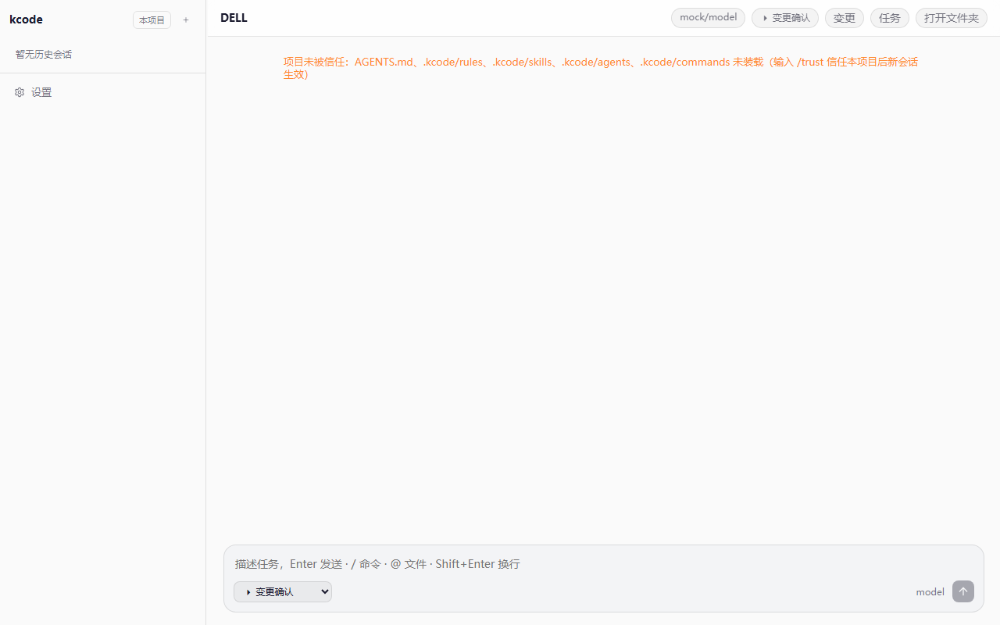
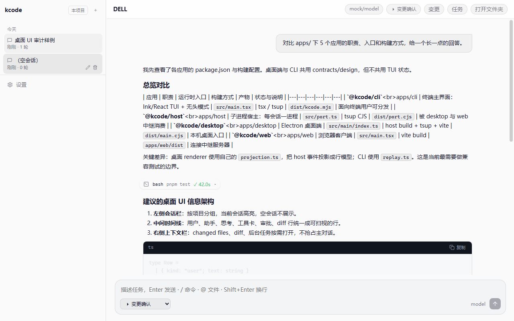
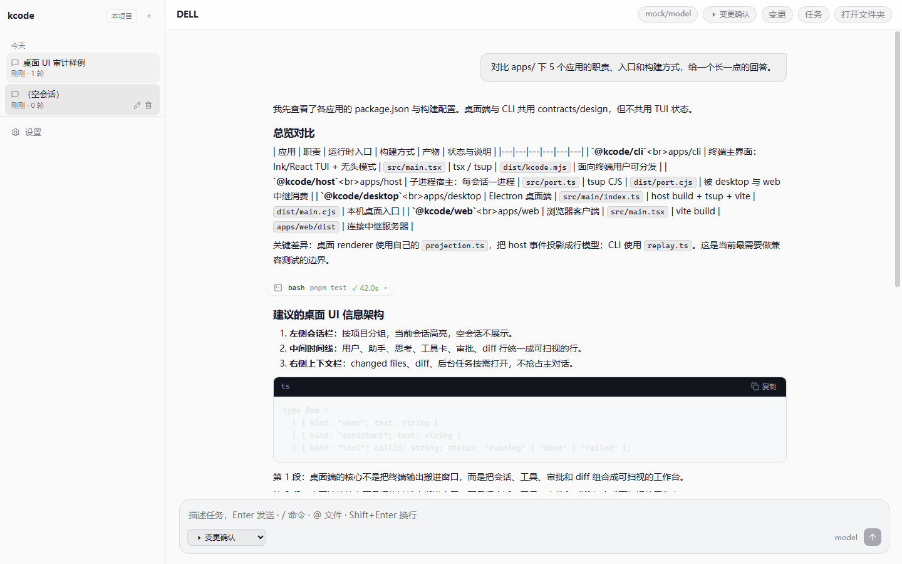
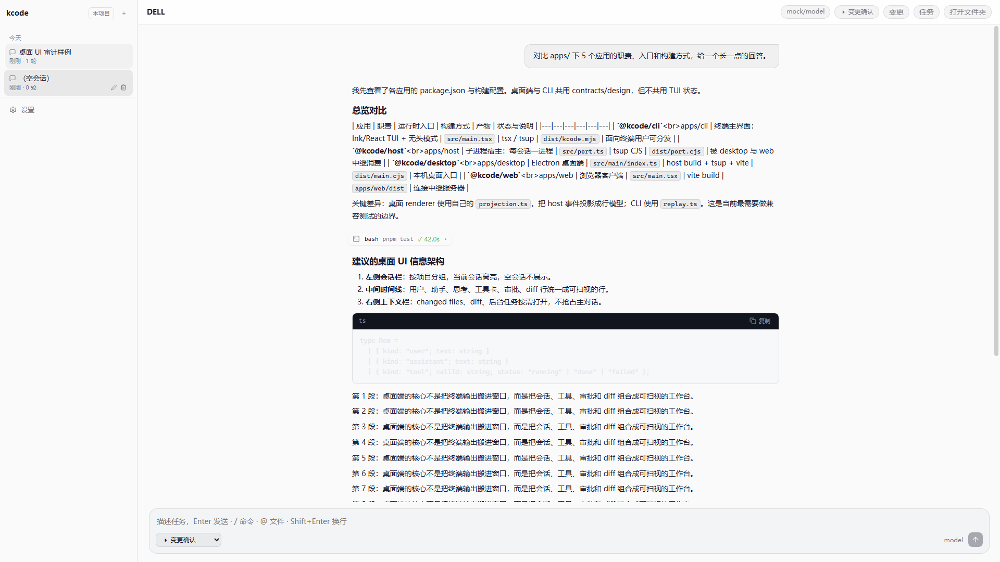
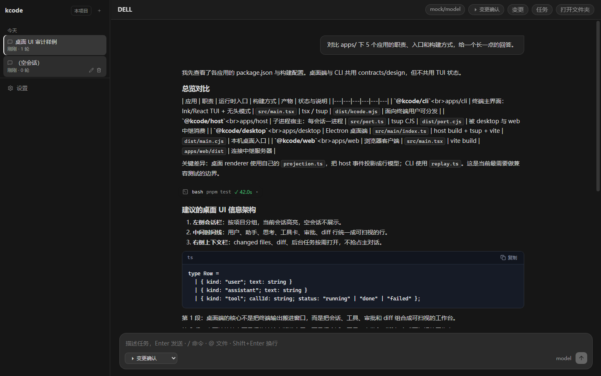
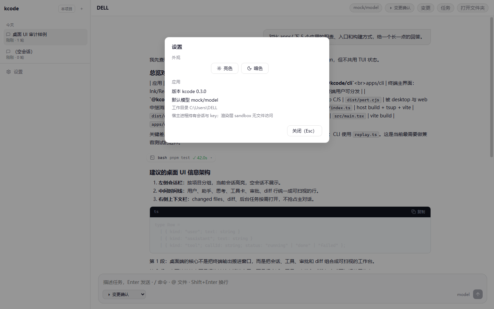
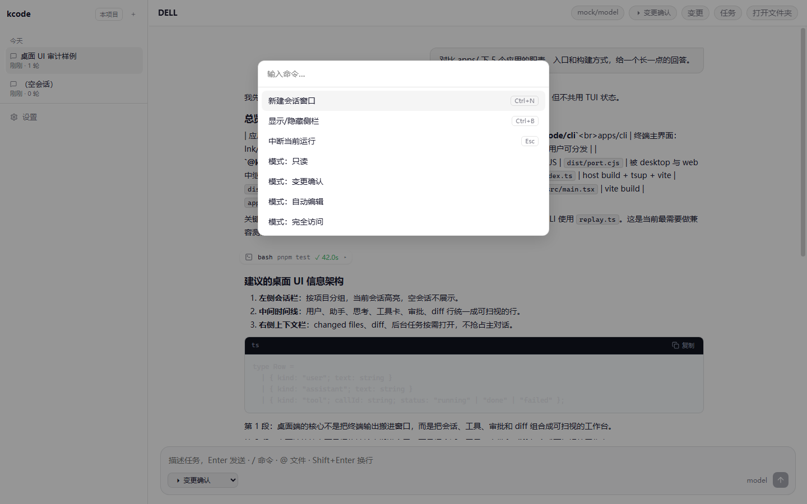
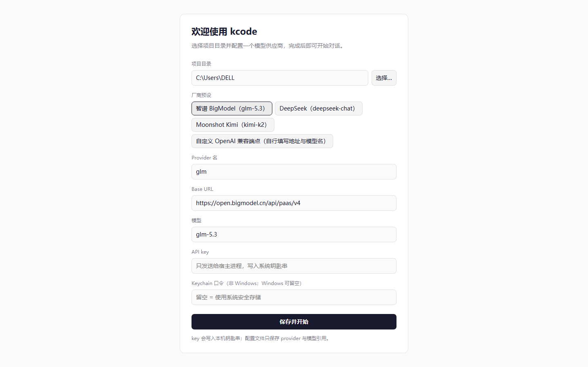

# 桌面 UI 审计（2026-10-23）

> 状态：**P0 启动链已修复，静态界面审计完成**。
> 已完成：空态、真实会话时间线、暗色、设置、命令面板、Onboarding 的截图与源码核对。
> 未覆盖：流式生成中、审批/plan 弹层、diff 侧栏、后台任务面板；这些需要单独造场景。

## 1. 结论

桌面端现在可以：

- 首启 → 创建会话 → 输入框可用；
- reload → 重挂端口 → 会话不退出；
- desktop E2E **2 passed**。

但 UI 层仍有明显问题，建议按 P1 顺序改，而不是整体重设计：

1. **空态被项目信任警告占满**，没有欢迎/示例任务；
2. **composer 与时间线宽度不一致**：正文 820px，输入框在主区拉满；
3. **侧栏仍显示 0 轮空会话**，且项目上下文不足；
4. **header 动作权重相同**，模型/模式/变更/任务/打开文件夹没有主次；
5. **亮色层次偏弱**，暗色反而更清楚；
6. **设计令牌两套来源**，主题改动容易漂移。

## 2. 审计环境

- Windows，Electron 37，打包态 `apps/desktop/dist`
- 假 `KCODE_HOME` + 假 `config.json` + 预置 JSONL 会话
- 1280×800 / 1440×900 / 1920×1080
- 亮色 / 暗色
- 截图目录：[docs/desktop-ui-audit](./desktop-ui-audit)

## 3. P0 修复记录

### 3.1 host CJS 产物崩溃（已修复）

修复前：

```text
TypeError [ERR_INVALID_ARG_VALUE]:
The argument 'filename' must be a file URL object,
file URL string, or absolute path string. Received undefined
    at createRequire ...
```

根因：CJS 打包把 `@anthropic-ai/sandbox-runtime` 内联后，产物里的 `import.meta.url` 变成 `{}`。

修复：

- [apps/host/tsup.config.ts](../apps/host/tsup.config.ts:15) 增加 `shims: true`。

### 3.2 首启 attach / hello / session-create 竞态（已修复）

修复前：输入框长期 `连接宿主中…`，但 sidebar 又能加载会话。

修复：

- [main/index.ts](../apps/desktop/src/main/index.ts:176)：attach 从 `did-finish-load` 提前到 `dom-ready`；
- [useDesktopConnection.ts](../apps/desktop/src/renderer/hooks/useDesktopConnection.ts:103)：hello 每 500ms 重试，ready 后停止；
- [main.tsx](../apps/desktop/src/renderer/main.tsx:147)：`session/create` 失败重试 3 次，并复位 `createdRef`，不再静默吞错。

### 3.3 reload 杀 host（已修复）

修复前：`page.reload()` 后显示“宿主进程已退出”。

修复：

- [apps/host/src/port.ts](../apps/host/src/port.ts:29)：最后一个端口关闭后等待 2s；新端口 attach 时取消退出倒计时。
- 现有 E2E 的 reload replay 路径恢复通过。

### 3.4 真正卡住首启的隐藏 P0：home 目录 repo map 扫描

修复 attach 后，`session/create` 仍然卡住。定位方式：

```powershell
KCODE_REPO_MAP=off
```

设成 off 后，会话立即创建成功，composer 立刻可用。

根因：desktop 默认 cwd 是用户 home；[composeSession](../packages/session/src/composition.ts:387) 启动时同步等待 `buildRepoMap(home)`，`fast-glob` 扫整个用户目录，导致 host 会话创建长时间不返回。

修复：

- [composition.ts](../packages/session/src/composition.ts:387)：cwd 是用户 home 时跳过 repo map；`KCODE_REPO_MAP=force` 可显式覆盖；
- [repo-map.ts](../packages/tools/src/tools/repo-map.ts:93)：增加扫描预算，默认 10s；会话组装修剪为 2s，超时降级为空 map，不再阻塞会话。

### 3.5 验证

```text
pnpm --filter @kcode/desktop exec playwright test test/e2e/desktop.spec.ts
→ 2 passed
```

- 首启 → host ready → composer 可输入
- reload replay → host 不退出
- 无配置 → onboarding

## 4. 静态界面审计

### 4.1 空态：仍是一屏空白



虽然 composer 已可用，主区仍然只有一条橙色项目信任警告，没有欢迎语、示例任务或输入引导。

源码原因：

- [main.tsx](../apps/desktop/src/renderer/main.tsx:338) 的 `isEmpty` 要求 `timeline.rows.length === 0`；
- 项目未信任时，`notice` 已进入 timeline，于是 `isEmpty=false`，草稿态 `draft-welcome` 不显示。

建议：

- 把“项目信任提示”从时间线行改为顶部可操作 banner；
- 或者 `isEmpty` 忽略 notice 行；
- 空态给 2–3 个可点击的示例任务 + 项目/模型上下文。

### 4.2 1280 会话：正文可读，但侧栏有脏数据



观察：

- 正文行宽约 820px，14px / 1.7，长段落可读；
- 侧栏同时出现：

```text
桌面 UI 审计样例
刚刚 · 1 轮

（空会话）
刚刚 · 0 轮
```

0 轮会话不应出现在桌面侧栏。CLI 已过滤，桌面没有：

- [SessionSidebar.tsx](../apps/desktop/src/renderer/components/SessionSidebar.tsx:64) 只按 workspace 过滤，没有 `turns > 0`。
- host `sessions/list` 也直接返回 0 轮会话。

建议在 desktop 侧栏或 host 列表层统一过滤，并补一条 E2E。

### 4.3 1440 会话：composer 比正文宽



观察：

- 时间线正文约 820px，居中；
- composer 从侧栏边缘一直拉到窗口右侧，约 1140px；
- 视觉上像“正文是窄栏，输入框是通栏”，缺少对齐关系。

相关 CSS：

- `.timeline-inner` / `.row-assistant` 有 `max-width: 820px`；
- `.composer` 没有 `max-width`。

建议：

```css
.composer {
  width: min(820px, calc(100% - 40px));
  margin-inline: auto;
}
```

或者在 `.main-column` 内加一个统一的 `--content-width` 容器，让 timeline 与 composer 共用。

### 4.4 1920 会话：空白进一步放大



观察：

- 主区约 1656px，正文仍 820px；
- composer 约 1600px；
- 侧栏仍 264px，宽屏没有增加项目/分支/任务信息；
- 宽屏下“内容宽窄”矛盾最明显。

### 4.5 暗色：层次更好，但输入区仍过宽



观察：

- 暗色下工具卡、标题、代码块层次比亮色清楚；
- 工具卡 `bash pnpm test ✓ 42.0s` 信息完整；
- 代码块标题栏/复制按钮可用；
- 橙色信任警告在暗色下仍是最亮元素；
- composer 仍通栏，与正文不对齐。

### 4.6 设置



观察：

- 480px 宽，层级清楚；
- “亮色 / 暗色”两个按钮没有明显选中态；
- 版本、默认模型、工作目录信息完整；
- “关闭 (Esc)”在右下角，鼠标用户移动距离较远；可加右上角关闭。

### 4.7 命令面板



观察：

- 520px 宽，列表可扫；
- 快捷键右对齐，符合桌面习惯；
- 四个“模式：”项重复前缀；
- 当前选中行只有淡背景，键盘焦点不够明确；
- 命令数量少时可接受，后续需要分组/搜索图标。

### 4.8 Onboarding



观察：

- 单卡片表单，层级清楚；
- 厂商预设平铺，选中态不明显；
- API key / Keychain 提示文案完整；
- “保存并开始”是明确主按钮；
- 卡片高度接近一屏，小窗口需要滚动。

## 5. 源码层问题

### 5.1 空会话未过滤（已确认）

桌面侧栏显示 0 轮会话，和 CLI 的 `/sessions` 过滤不一致。

### 5.2 桌面有独立事件投影

- [projection.ts](../apps/desktop/src/renderer/components/projection.ts:9)

CLI 用 `replay.ts` / `events.ts`，两端没有共享 fixture。CLI 事件语义变化时，桌面可能少行/错状态。

建议在 UI 改版前补：

```text
同一份 SessionEvent fixture
  → CLI replayBlocks()
  → desktop applyEvent()
  → 断言行类型/数量/关键字段
```

### 5.3 设计令牌重复

- [main.tsx](../apps/desktop/src/renderer/main.tsx:28) 注入 `webCssTheme()`；
- [styles.css](../apps/desktop/src/renderer/styles.css:9) 又定义一套 `--z-*`。

后续做主题/暗色调整会反复踩覆盖顺序。建议 `@kcode/design` 作为唯一 token 源。

### 5.4 侧栏刷新是 30s 轮询

- [SessionSidebar.tsx](../apps/desktop/src/renderer/components/SessionSidebar.tsx:57)

会话完成后标题/时间最多延迟 30s。建议事件驱动或完成后主动刷新。

### 5.5 侧栏宽度不持久化

- [WorkspaceLayout.tsx](../apps/desktop/src/renderer/components/WorkspaceLayout.tsx:27)

拖拽只改 CSS 变量，reload 后回 264px。P2。

## 6. 建议的 P1 顺序

1. **空态引导**：信任提示改 banner，补 `draft-welcome`；
2. **内容宽度统一**：timeline 与 composer 共用 820px 容器；
3. **侧栏过滤空会话** + 补 E2E；
4. **header 层级**：模型/模式为状态，变更/任务/打开文件夹降为次级；
5. **亮色层次**：侧栏/主区/卡片用更明确的分层；
6. **设置选中态 / 关闭按钮**；
7. **命令面板分组与焦点**；
8. **跨端事件 fixture**。

## 7. 下一步

P0 已清，桌面可以进入 UI 迭代。建议先做 **P1-1 空态 + P1-2 宽度统一**，这两项改动小、截图收益最大；然后再做侧栏过滤和 header 层级。

## 8. 审计产物

- 截图：[docs/desktop-ui-audit](./desktop-ui-audit)
- 本文件：[docs/desktop-ui-audit.md](./desktop-ui-audit.md)
- 桌面 E2E：[desktop.spec.ts](../apps/desktop/test/e2e/desktop.spec.ts)
- UI 原型：[desktop-ui-design.md](./desktop-ui-design.md)
