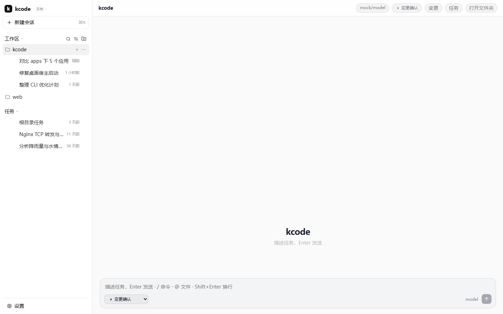
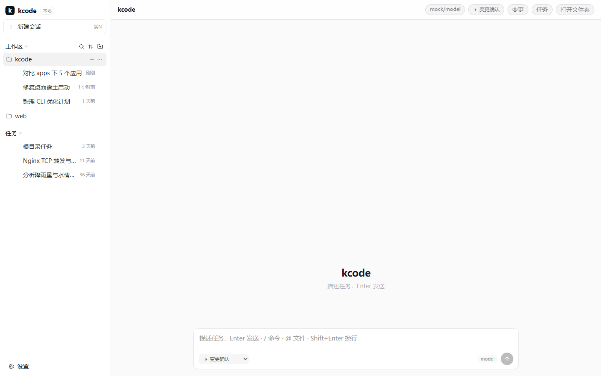
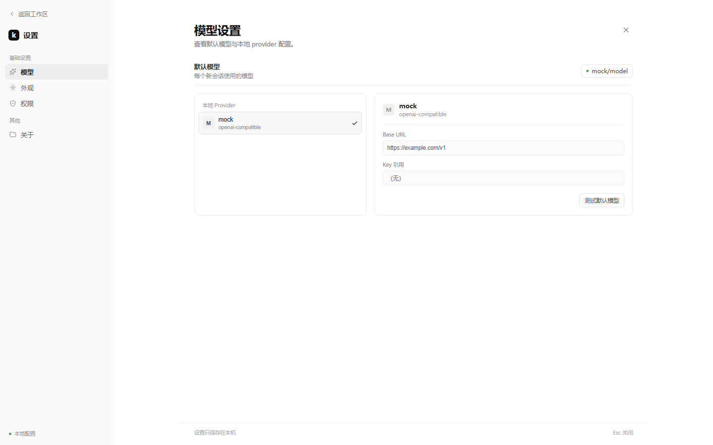
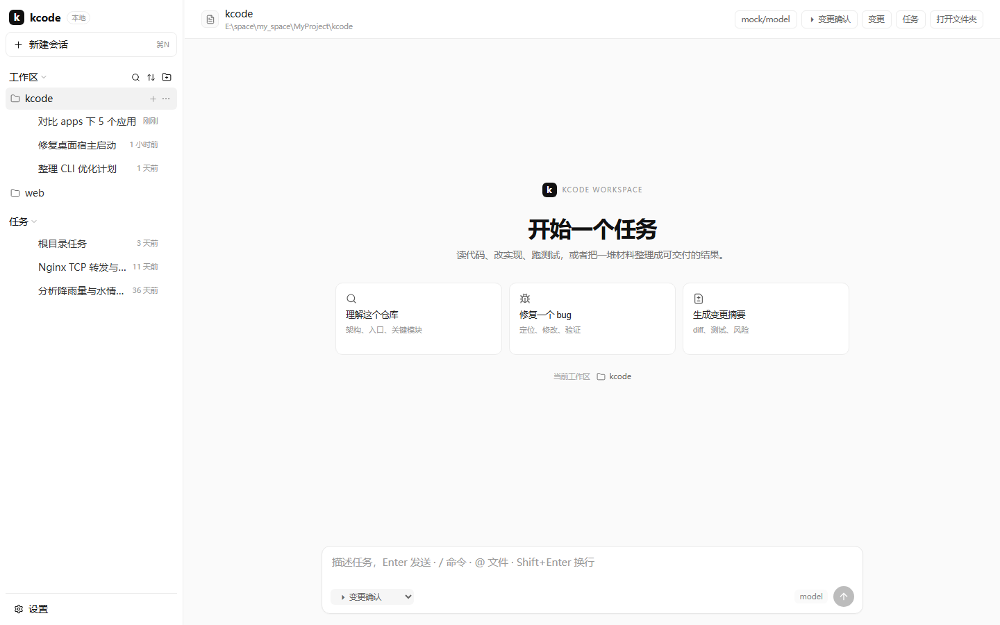
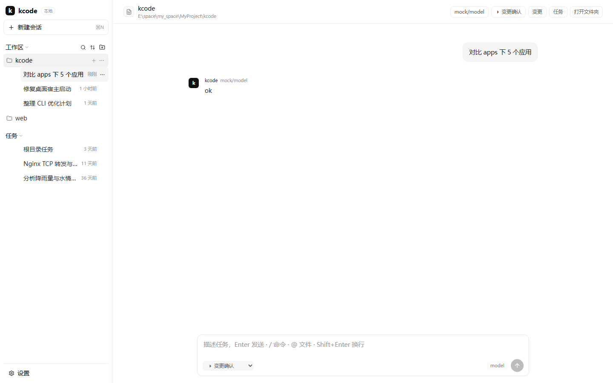
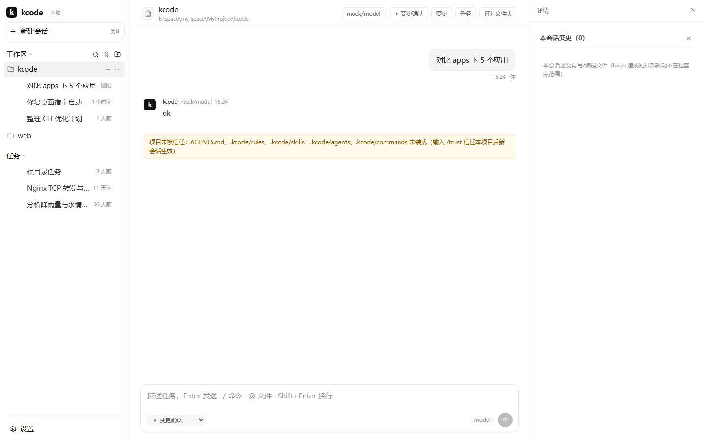

# Desktop UI v2 落地计划

> 状态：**Slice 1、工作区注册/信任 RPC、Slice 2 Composer、Slice 3 设置页、主区域壳层、时间线 v2、diff 详情栏、任务归档、host 会话索引/软删除已落地**
> 基线原型：`docs/desktop-ui-design/index.html`（v23）
> 设计说明：`docs/desktop-ui-design.md`
> 范围矩阵：`docs/desktop-ui-scope-matrix.md`（P0 按钮/交互冻结）
> 目标：把已定形的纯白桌面原型拆成可实施的最小 UI 版本，不把原型里的 mock 当成产品能力。
>
> 决策前提：**D3-UI 例外已登记**（2026-10-23，见 [desktop-ui-exception.md](./desktop-ui-exception.md)）；**工作区 RPC 例外已登记**（2026-10-24，见 [desktop-workspace-rpc-approval.md](./desktop-workspace-rpc-approval.md)）。

---

## 0. 结论先行

下一步不要做“完整 ZCode 克隆”，而是按 vertical slice 推进。Slice 1 已完成：

1. 纯白设计令牌；
2. 桌面壳：静态产品标识 + 工作区/任务树；
3. 会话切换、新建、重命名、删除；
4. 现有对话时间线 + 现有 Composer；
5. 设置只做外观 + 默认模型的已有能力。

工作区注册/信任留在 Slice 4。

**第一版明确不做**：自动缩略的上下文百分比、Provider 套餐额度、思考强度、附件、终端、插件市场、自动化、归档、MCP/Hooks/命令完整表单。

---

## 1. 当前产品基线

### 1.1 Renderer 现状

| 文件 | 现状 | 影响 |
|---|---|---|
| `apps/desktop/src/renderer/main.tsx` | 499 行，单文件持有连接、会话、时间线、Composer、设置、侧栏、命令面板 | 新 UI 不能继续堆在这个文件里 |
| `SessionSidebar.tsx` | 扁平会话列表，按 workspace 过滤，今天/本周/更早分组 | 没有项目树、折叠、归档 |
| `WorkspaceLayout.tsx` | 三栏布局 + 可拖拽侧栏 + 右侧 SidePane | 可复用，但样式与间距要按 v19 调整 |
| `Composer.tsx` | 纯文本输入 + `/`/`@` 菜单 + 权限下拉 + 模型只读标签 | 没有附件、模型选择、思考强度、上下文容量 |
| `SettingsOverlay.tsx` | 外观 + 版本/模型/cwd 信息 | 没有 Provider 管理、模型列表 |
| `projection.ts` | 事件 → 时间线行 | 没有 usage/context 状态 |
| `WorkspaceHeader.tsx` | 项目名 + 模型/模式/变更/任务 badges | 视觉与 v19 顶栏差异较大 |

### 1.2 现有 host 能力（可复用）

已存在：

- `session/create`（`model`, `cwd`, `resumeFrom`）
- `session/dispose` / `session/replay`
- `session/submit`
- `session/interrupt`
- `session/set_mode`
- `session/set_model`
- `session/commands` / `session/command`
- `session/compact` / `session/files`
- `session/tasks` / `session/task_stop`
- `session/changes` / `session/revert`
- `config/get` / `config/save`
- `models/list` / `provider/probe`
- `sessions/list` / `sessions/rename` / `sessions/delete`

`sessions/list` 已返回：

```ts
{
  sessionId: string;
  preview: string;
  turns: number;
  modifiedAt?: number;
  workspaceKey?: string;
  title?: string;
}
```

这意味着**项目/任务分组可以从现有会话数据推导**，不需要先改 host 存储。

### 1.3 现有 host 没有的能力

| 原型能力 | host 现状 | 处理 |
|---|---|---|
| 项目（workspace）注册表 | 无；只有会话的 `workspaceKey` | 新增 host 侧项目注册表 |
| 项目信任查询/设置 | session 包有 `trustProject`/`isProjectTrusted`，host 没暴露 RPC | 新增 `workspace/*` 方法 |
| 项目归档/删除 | 无 | 新增项目注册表状态 |
| 任务归档 | 无；只有 `sessions/delete` | P1 再补；P0 只做删除 |
| 附件 | `session/submit` 只有 text | 不做；等协议扩展 |
| 上下文容量 | 只有 `session_end.usage`，没有 live context/window | P0 不显示百分比 |
| 思考强度 | provider 无请求参数/模型能力元数据 | 隐藏，不造假 |
| Provider 套餐/额度 | 无 | 不做 |
| 终端 / 右侧面板 | 无 host API；Electron 有原生能力但未抽象 | P2 |
| 插件市场 / 自动化 / MCP 表单 | 无对应 UI 协议 | P2 |

**原则：不在 renderer 里假装这些能力存在。** 原型里的百分比、套餐、归档、终端一律视为 mock。

---

## 2. 目标 UI 范围（P0）

### 2.1 视觉基线

- 纯白背景：`#ffffff`
- 侧栏：`#fafafa`
- 边框：`#ececec`
- 正文：`#111111`
- 字体：UI 14px / 任务 14px / 次级 12.5px / 元信息 11px / 对话正文 14.5px
- 项目行 30px；任务行 46px
- 主对话宽度：780px
- 侧栏：244px（允许拖拽 200–480）

### 2.2 组件边界

建议新增/重构：

```text
apps/desktop/src/renderer/
  App.tsx                       ← 只做 provider/连接/顶层状态
  components/
    DesktopShell.tsx            ← 顶栏 + 侧栏 + 主区
    ProductTabBar.tsx           ← logo + kcode + 本地
    TaskListSidebar.tsx         ← 项目/任务树
    ProjectGroup.tsx
    TaskRow.tsx
    ConversationView.tsx
    ComposerV2.tsx              ← 纯视觉重排；功能等价现有 Composer
    SettingsPage.tsx            ← 只接现有配置
  lib/
    task-tree.ts                ← 纯函数：分组、折叠、自动展开
    project-registry.ts         ← 调 host 项目 RPC（P0.5）
```

保留现有：

- `WorkspaceLayout`（先复用，后续再决定是否替换）
- `Timeline` / `rows.tsx` / `ToolCallRow` / `SidePane`
- `useDesktopConnection` / `useDesktopCommands`

### 2.3 侧栏行为

```text
[ K ] kcode  本地

+ 新建会话
对话 / 自动化 / 插件市场

任务列表
项目
  kcode
    任务 A
    任务 B
  web
    任务 C
任务
  未归类任务
```

P0 行为：

- 项目由 `workspaceKey` 归组；
- 项目行 hover 显示 `+` 和 `...`；
- 项目行点击选中并自动展开；
- 项目 `⌄` 可独立折叠/展开；
- 任务行点击续接（`session/create` + `resumeFrom`）；
- 任务 `...`：重命名、删除；
- 新建会话进入当前选中项目；“任务”组进入未归类；
- 空 workspaceKey 的旧会话进入“任务 / 未归类”；
- 删除当前会话时要先切走或给出明确阻止提示。

P0.5：

- 项目新增（`pickDirectory`）；
- 项目信任（host RPC）；
- 项目注册表持久化；
- 项目删除/归档。

---

## 3. Host 改造建议

### 3.1 先加项目注册表（UI-only 例外内最小协议）

建议新增：

```text
workspace/list
workspace/add
workspace/remove
workspace/archive
workspace/trust
workspace/status
```

存储位置建议：

```text
~/.kcode/desktop/projects.json
```

字段：

```ts
interface DesktopProject {
  id: string;              // workspaceKey
  path: string;
  name: string;
  trusted: boolean;
  archivedAt?: number;
  createdAt: number;
  updatedAt: number;
}
```

设计约束：

- 只存项目组织信息，不复制会话；
- `remove` / `archive` **不删除本地目录**；
- `trust` 复用 `packages/session` 的 `trustProject`；
- 信任变更后旧 session 不能继续使用旧规则，下一次 `session/create` 生效；
- `workspace/list` 返回注册表 + 从 `sessions/list` 推导出的未注册 workspace。

### 3.2 任务归档（P1）

若要做原型里的“归档任务”，需要：

```text
sessions/archive
sessions/unarchive
```

并在 host 侧保存：

```text
~/.kcode/desktop/task-state.json
```

P0 不做；先只做删除。

### 3.3 附件 / 上下文 / 思考（P2）

需要先扩 `SessionSubmitParams` 和 `SessionEvent`：

- 附件：`images` / `attachments` 路径 + 类型 + 预览；
- 上下文：live context usage、model context window；
- 思考：模型能力 + reasoning effort 参数。

没有协议前，UI 不显示这些控件，避免假交互。

---

## 4. 设计令牌落地

当前 `packages/design/src/web.ts` 仍是旧 Web 主题：

- `brand: #0891b2`
- `accent: #7c3aed`
- 暗色媒体查询

这与 v19 的纯白中性色冲突。**不要直接改 `WEB_LIGHT`/`WEB_DARK`**，否则影响 CLI/Web。

建议新增：

```text
packages/design/src/desktop.ts
```

导出：

```ts
DESKTOP_LIGHT = {
  background: "#ffffff",
  panel: "#fafafa",
  elevated: "#ffffff",
  ink: "#111111",
  inkSoft: "#333333",
  muted: "#666666",
  faint: "#999999",
  line: "#ececec",
  lineStrong: "#d6d6d6",
  accent: "#2563eb",
  success: "#17803d",
  warning: "#b45309",
  danger: "#c24141",
}
```

以及：

```ts
DESKTOP_TYPE = {
  ui: 14,
  title: 14,
  secondary: 12.5,
  meta: 11,
  body: 14.5,
}
DESKTOP_SPACING = [2, 4, 6, 8, 10, 12, 16, 20, 24, 32];
DESKTOP_RADII = [4, 6, 8, 10, 12, 16];
```

桌面专属的字体、行高、行高尺寸可以放在 `DESKTOP_*`，不必污染语义色。

生成 CSS 变量时使用 `--kc-*` 前缀，避免和现有 `--z-*` 冲突；迁移完成后再删除旧变量。

---

## 5. 实施切片

### Slice 1：静态壳（已落地）

已实现：

- `packages/design/src/desktop.ts`：桌面专用 `--kc-*` 令牌，不动 `WEB_LIGHT` / `WEB_DARK`；
- `DesktopSidebar.tsx`：产品标识、新建会话、工作区/任务树、搜索/排序/文件夹加号；
- `desktop-v2.css`：纯白侧栏样式；
- feature flag：
  - 默认启用 v2；
  - `localStorage["kcode-desktop-ui-v2"] = "classic"` 或 `?ui=classic` 回退旧侧栏；
- 复用现有 `WorkspaceLayout` / `Timeline` / `Composer` / `useDesktopConnection`；
- 工作区由 `sessions/list.workspaceKey` 推导；
- 单工作区会话展开/折叠，工作区列表整体展开/折叠，任务组展开/折叠；
- 任务重命名/删除走现有 host RPC；
- 新建会话可指定选中工作区，跨工作区任务可续接。



本地启动：

```powershell
pnpm --filter @kcode/desktop dev
```

`dev.mjs` 会清理 `ELECTRON_RUN_AS_NODE`，使用独立的 dev userData，并在 Windows dev 下关闭 sandbox/GPU，避免 Chromium singleton 与受限会话启动失败。

P0 限制（工作区注册/信任 RPC 后）：

- 历史空会话不进入树；当前空会话显示“新任务”，即使 `sessions/list` 还没落盘也会显示当前草稿；
- 发送首条消息后侧栏立即刷新 `sessions/list`；文件摘要未更新时先用时间线首条用户消息更新标题；
- 新建会话立即写入 renderer 本地会话索引（sessionId / cwd / createdAt / preview）；host 列表未及时返回时先乐观显示，host 返回后按 id 合并；
- 切换会话先清空时间线并临时关闭“可发送”，等 `session/create` 返回新 id 后再恢复，避免消息写入已 dispose 的旧会话；
- 工作区展开状态按 key 独立保存（Set），打开一个工作区不会折叠其他工作区；顶层“工作区”只统一收起/展开分组行；
- 只有当前空草稿会临时归入当前工作区；点击无 `workspaceKey` 的历史会话不会“搬进”分组，仍留在“任务”；
- 旧版 `session_start` 没有 `workspaceKey` 时，renderer 用创建/续接时记录的 sessionId → cwd 兜底分组；v2 映射会丢弃旧版误记的点击归属；
- 会话 id 以 `session/create` 响应为准，事件流里的旧 `session/created` 不再覆盖当前会话；
- “任务”组默认折叠；搜索非空时强制显示匹配结果；
- 工作区顺序固定为注册表创建顺序，切换/新建任务不会改变分组顺序；未注册工作区按名称稳定排序；
- `workspaceKey="/"` 的旧会话不生成根工作区，非空内容归入“任务”；
- 工作区注册表在 host：`~/.kcode/desktop/projects.json`；
- 任务归档：`~/.kcode/desktop/task-state.json`；
- 信任复用 `~/.kcode/trusted-projects.json`，UI 只调用 host RPC；
- 未做附件/上下文/思考；
- 工作区菜单提供“信任 / 新建任务 / 复制路径 / 从列表移除”，不做无后端依据的归档。

验收：

- 1440/1280 无横向溢出；
- 项目 30px、任务 46px；
- 选中项目自动展开；
- 点击任务调用现有 `onResume`；
- 原有 E2E 仍绿。

### Slice 2：Composer 视觉重排（已落地）

- 纯白 12px 圆角输入框，与侧栏同一组 `--kc-*` 色；
- 宽度上限 820px，与时间线对齐；
- 权限选择左侧；
- 模型只读标签右侧；
- 发送/停止为圆形按钮；
- 不加附件、思考、上下文控件；
- 复用现有 `onModeChange` / `onSend` / 队列 / `/` / `@`。

验收：

- 发送/停止/队列行为与现版一致；
- `/` 与 `@` 菜单仍可用；
- 不新增伪造控件。



### Slice 3：设置最小版（已落地）

- 原型式全页设置：左侧导航 + 右侧内容；
- 模型：默认模型、provider 列表、Base URL / keyRef、测试连接（host `provider/probe`）；
- 外观：跟随系统 / 亮色 / 暗色；
- 权限：当前工作区信任 + 已登记工作区信任（host `workspace/trust`）；
- 关于：版本、默认模型、工作目录、配置位置；
- 不显示套餐额度、MCP/Hooks/技能等无后端页面。



验收：

- 设置可打开/关闭（Esc）；
- 模型信息来自 `config/get`；
- 测试连接调用 `provider/probe`；
- 工作区信任调用 `workspace/trust`；
- 不新增假数据。

### 主区域壳层（已落地）

- `WorkspaceHeader` 改为项目图标 + 标题 + cwd + 右侧紧凑操作；
- 空会话改为原型式“开始一个任务”+ 三个可点击提示卡；
- 提示卡点击后填入 Composer，可直接编辑再发送；
- 当前工作区显示在空态底部；
- 不增加附件/上下文等未实现控件。



### 时间线 v2（已落地）

- 用户消息右对齐浅灰气泡；
- 助手行黑底 `k` 头像 + `kcode` + 模型；
- 工具卡改为白底圆角，状态显示“通过/失败/运行中”；
- 信息提示（信任警告等）改为浅色 inline 条；
- Markdown 正文、行内代码、链接、代码块按浅色背景重新取色；
- 虚拟滚动、流式 live-tail、审批/计划面板逻辑不变。



### 流式布局稳定性

- live-tail 外层新增与虚拟列表同宽（820px）的 `timeline-live-wrap`；
- 流式内容与落定 assistant 行使用同一 padding/meta/宽度；
- 不再每个 token 调 `scrollToIndex`；只在新行落定时定位，流式内容只贴底；
- 避免“输出内容闪到旁边再跳回来”的横向/纵向跳动。

### 详情栏 / diff（已落地）

- `edit` / `write` 有 `preview` 时改为独立 diff 卡：文件图标、文件名、路径、`+/-`、查看；
- 右侧详情栏改为 360px 纯白栏；
- 变更列表、逐文件回退、全部回退；
- diff 行浅色增删背景；
- 不是 `main.tsx` 的 fake diff，仍使用 host 的 `row.preview` / `session/changes`。



### Slice 4：工作区注册 + 信任（已落地）

- `workspace/list/add/remove/trust/status`
- 存储 `~/.kcode/desktop/projects.json`
- 添加工作区：`pickDirectory` → `workspace/add`
- 新工作区可选立即信任；旧工作区菜单可补信任
- 信任复用 `@kcode/session` 的 `trustProject` / `isProjectTrusted`
- 新工作区创建后自动选中并展开
- 信任后下一次 `session/create` 生效
- 移除只删注册项，不删目录/会话

验收：

- 选文件夹 → 工作区出现；
- 取消 → 不写入；
- 已信任工作区不再显示“信任工作区”；
- 移除工作区不删除目录；
- 当前工作区不可静默移除；
- host store 3 tests passed。

### 会话索引（Phase 1/2，已落地）

- host 新增 `~/.kcode/desktop/session-index.json`；
- `session/create` 在返回前写入 `{sessionId, workspaceKey, createdAt}`；
- `sessions/list` 合并索引：空会话、刚创建未写 JSONL 的会话也能出现；
- 每次列表用 JSONL 摘要回填索引（preview/title/updatedAt）；
- `sessions/rename` 同步标题到索引；
- 实际 JSONL 有摘要/标题/更新时间时以文件为准，索引只补归属；
- `sessions/delete` 改为软删除：写 `session-trash.json`，不删 JSONL；
- `sessions/restore` 恢复；侧栏“回收站”可展开恢复；
- 回收站“清空”调用 `sessions/empty_trash`，只物理删除回收站内会话；
- 不自动按时间清理回收站，避免误删；
- host 在 create/delete/restore/archive/rename/purge 后广播 `sessions/changed`，多窗口侧栏立即刷新；
- 索引最多 500 条，原子临时文件 rename，进程内串行写；
- renderer localStorage 仍是乐观 UI 缓存，host 索引是权威补充。

### Slice 5：任务删除 & 空态（部分落地）

- 删除非当前任务（已有）；
- 当前任务删除保护（已有）；
- 空工作区/空任务态（已有）；
- 新建任务归属规则（已有）；
- **任务归档**（新增）：
  - host `sessions/archive`；
  - 状态 `~/.kcode/desktop/task-state.json`；
  - 工作区树隐藏归档任务；
  - 侧栏底部“已归档”分组，默认折叠；
  - 菜单支持“归档任务 / 取消归档”；
  - 删除任务时同步清理归档状态。

---

## 6. 状态模型

新增纯函数模型，便于单测：

```ts
interface ProjectNode {
  id: string;
  name: string;
  path: string;
  trusted: boolean;
  collapsed: boolean;
  tasks: TaskNode[];
}

interface TaskNode {
  sessionId: string;
  title: string;
  modifiedAt?: number;
  turns: number;
  workspaceKey?: string;
}
```

`lib/task-tree.ts` 只负责：

- 按 `workspaceKey` 分组；
- 未归类；
- 排序；
- 选中/展开；
- 计数不显示但可内部用。

React 组件只渲染，不直接做数据变换。

---

## 7. 测试计划

### 已实现（Slice 1）

`apps/desktop/test/e2e/desktop-v2.spec.ts` 覆盖：

- 工作区由 `sessions/list.workspaceKey` 分组；
- 单个工作区展开/折叠；
- 工作区标题整体展开/折叠，整体展开时不打开会话；
- 任务组展开/折叠；
- 任务菜单重命名走 `sessions/rename`；
- 工作区搜索；
- `?ui=classic` / localStorage 旧侧栏回退。

当前结果：

```text
desktop E2E 3 passed
desktop typecheck passed
design typecheck passed
```

### 待补

- 纯函数分组/排序单测（后续抽 `task-tree.ts` 时补）；
- 新建会话进入选中工作区；
- 跨工作区续接；
- 当前会话删除保护；
- 工作区文件夹加号（需要 mock `pickDirectory`）。

### 视觉

- 1440×900、1280×800 亮色；
- 关键状态截图（项目折叠、任务组折叠、设置 Provider）；
- 不用截图断言代替 DOM 行为断言。

---

## 8. 风险与约束

1. **一个 host 会话进程**：切换项目/会话必须 `dispose` 后 `create`；不能并发。
2. **信任是 session 构造期生效**：信任后必须新会话，UI 要说明“下次新会话生效”。
3. **sessions/list 是唯一任务源**：项目无任务时不能只靠它推断；需要项目注册表。
4. **不要用 localStorage 存项目/归档**：跨窗口、重装、测试夹具会不一致；放 host 侧文件。
5. **不要改 CLI/TUI**：设计令牌新增文件，不改现有 `WEB_LIGHT`。
6. **不要先做附件/思考/上下文百分比**：协议没有，做了就是假功能。
7. **Windows 路径**：workspaceKey 已规范化；UI 显示用 basename，不自行 replace。
8. **当前会话不能删除**：host 已有保护，UI 要提前解释。

---

## 9. 验收清单

- [ ] 纯白令牌进入 `packages/design`，没有复制到 `apps/desktop` 作为唯一来源。
- [ ] 侧栏项目/任务分组可折叠，点击项目自动展开。
- [ ] 任务行高度稳定，切换不跳动。
- [ ] 新建任务进入当前项目；未归类入口正确。
- [ ] 任务删除/重命名沿用 host 现有 RPC。
- [ ] 项目新增通过 `pickDirectory`，取消不写入。
- [ ] 项目信任通过 host RPC，且只在下次会话生效。
- [ ] 删除/归档项目不删除目录。
- [ ] 设置只展示 host 真正拥有的配置。
- [ ] 不出现附件/思考/上下文百分比/套餐额度的假交互。
- [ ] 原有 `desktop E2E` 保持通过。
- [ ] `pnpm gates:check` 通过。

---

## 10. 推荐下一步

先做 **Slice 1 + 2**，不要先碰全部设置页：

```text
1. 新增 desktop token
2. 拆 DesktopShell/TaskListSidebar
3. 复用 Timeline/Composer 现有行为
4. 保持 feature flag 可回退
5. 再接项目注册/信任 RPC
```

项目注册/信任是 host 改动点，建议单独开一个 PR；UI 壳与 Composer 重排可以先独立合并，降低回滚成本。
